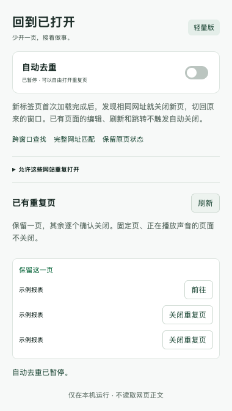

# 回到已打开 · Tab Return Lite

Chrome 中文轻量扩展：重复打开网页时，关闭新标签页，切回已经打开的页面及窗口。

这是 [Peuj/duplicate-tabs-closer](https://github.com/Peuj/duplicate-tabs-closer) 的精简 fork。保留上游 Git 历史、许可证与图标，针对日常数据开发重新整理运行代码和中文界面。



## 使用

1. 克隆本仓库，或下载源代码后解压。
2. 在 Chrome 中打开 `chrome://extensions`，开启右上角“开发者模式”。
3. 点击“加载已解压的扩展程序”，选择仓库中的 **`extension` 文件夹**。
4. 固定工具栏上的“回到已打开”。默认开启自动去重，范围覆盖同一 Chrome 配置文件中的所有普通窗口。

无需安装 Node.js 或执行构建即可使用。若拿到 `npm run package` 生成的 ZIP，解压后直接选择含 `manifest.json` 的文件夹。

不要同时开启另一个自动去重扩展，以免两个扩展同时处理同一组标签页。

## 行为约定

- **新开的网页**：首个 HTTP(S) 页面加载完成后，查找相同网址；找到后关闭新页，激活原页并切回原窗口。原窗口最小化时将其恢复。
- **保留原页状态**：不刷新、不移动原标签页，因此原页未提交的编辑内容继续保留。
- **已有网页**：编辑、刷新和站内跳转不触发自动关闭。此前积累的重复页可在弹窗中查看，逐个确认关闭。
- **完整匹配网址**：保留路径、查询参数、参数顺序和 `#` 锚点，不按标题或域名合并。
- **暂停**：开关关闭后允许自由打开重复页；恢复时只处理之后新开的页，不追溯清理。
- **排除网站**：每行一个域名，例如 `example.com`；该域名及其子域名都允许重复打开，也不列入手动清理。
- **保护页面**：新页如果已固定或正在播放声音，不自动关闭。手动清理也保护这些页面。
- **普通配置文件内运行**：不跨 Chrome 用户配置文件，不在无痕模式运行，不处理 `chrome://`、本地文件或扩展页面。

## 数据开发场景

默认规则适合任务、报表和在线 SQL 编辑器：

| 示例 | 结果 |
|---|---|
| 两次打开 `/task?id=100` | 关闭新页，回到原页 |
| `/task?id=100` 与 `/task?id=101` | 分别保留 |
| `/report?id=100#sql` 与 `/report?id=100#result` | 分别保留 |
| 同一 URL，已有编辑页未保存 | 保留原页，不刷新 |
| 同一页面需要并排比较 | 先暂停，或将该网站加入排除名单 |

对 Dorado、风神这类页面，不默认忽略任何查询参数。跟踪参数不同也会分别保留；如后续有明确的页面身份规则，再按具体网站增加归一化规则。

扩展无法看到网页正文，也无法判断不同标签页中的业务状态是否相同。需要长期保留多个相同 URL 的编辑器、首页或工作台时，应将该网站排除。

## 范围与边界

- 自动模式等待首个网页加载完成，允许首次 HTTP 重定向；超过 60 秒仍未完成则放弃自动关闭。
- 首个页面加载完成后发生的客户端跳转、SPA 路由改变，不再自动去重，可以手动处理。
- 新建空白页可以稍后输入网址；一分钟计时从首次 HTTP(S) 导航开始。
- Chrome 启动事件后的 10 秒暂不登记新页，减少会话恢复期间的自动关闭。这是启动宽限，并非对所有慢速恢复过程的完整识别。
- 两张页同时首次加载时保留一个可用副本，不保证以标签创建时间决定先后；已有可用页面优先作为返回目标。
- 右键“复制标签页”也会去重；需要有意复制时先暂停。
- 设置更新不会关闭已打开的页面。后台休眠后，未完成新页的识别状态从会话存储恢复。

## 轻量化

只保留 `tabs` 和 `storage` 两项权限，使用 Chrome Manifest V3 后台事件。无运行时依赖，无内容脚本，无远程请求、统计上报或定时轮询。

删除上游的多语言资源、主题系统、图标字体、模糊标题比较、正则规则编辑器、Firefox 容器和 Tree Style Tab 兼容层。保留中文弹窗、跨窗口返回、暂停、网站排除、重复页手动清理。

设置只存储在本机 `storage.local`；候选标签 ID 和加载时间存储在 `storage.session`，不保存浏览历史或网页正文。

## 开发与验证

Node.js 22 或更高版本：

```bash
npm ci
npm test
npm run check
npx playwright install chromium
npm run test:browser
npm run package
```

`npm test` 使用 Node 内置测试器。Playwright 只作为开发依赖，用于在独立临时配置文件中验证真实扩展；不进入安装包。无界面模式验证窗口激活请求和标签选中状态；操作系统窗口焦点需运行 `HEADED=1 npm run test:browser`，并保持测试浏览器在前台。

测试覆盖完整 URL 匹配、窗口激活、原页输入保留、不同参数和锚点、HTTP 重定向、暂停、排除、手动关闭、并发打开、目标变化及 MV3 后台重启。浏览器界面截图输出到 `test-results/popup.png`。

```text
extension/       可直接加载的扩展，零运行时依赖
  core.js        匹配、状态和关闭流程
  background.js  Chrome 事件与弹窗消息
  popup.*        中文弹窗
  icons/         保留的上游图标
scripts/         语法和权限检查、打包
tests/           单元测试和独立浏览器测试
```

## 来源与许可证

沿用 [GPL-3.0](LICENSE)。上游版本与变更说明见 [NOTICE.md](NOTICE.md)。本分支是独立维护的精简版本，不代表上游作者。

实现参考 Chrome 官方文档：[Tabs API](https://developer.chrome.com/docs/extensions/reference/api/tabs)、[Windows API](https://developer.chrome.com/docs/extensions/reference/api/windows)、[Storage API](https://developer.chrome.com/docs/extensions/reference/api/storage)、[Service worker 生命周期](https://developer.chrome.com/docs/extensions/develop/concepts/service-workers/lifecycle)。
